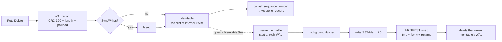
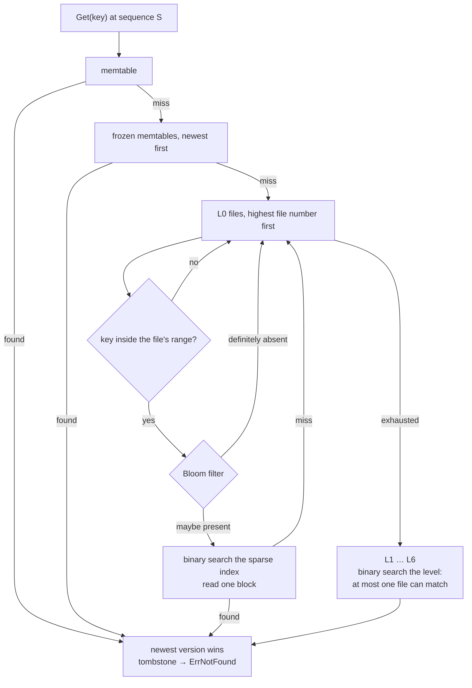
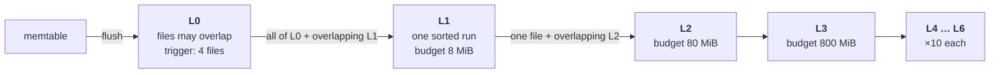

# keelstore

> **Учебная реализация, созданная вместе с AI-агентом** (август 2026). Цель — разобраться, как устроена такая система изнутри; архитектуру и ограничения автор готов объяснить. Это не production-библиотека.
> *A learning implementation built together with an AI agent; not a production library.*

**An embedded LSM-tree key/value store, written from scratch in Go.**


keelstore is the kind of engine that sits underneath RocksDB, Pebble and
LevelDB: a write-ahead log, a skiplist memtable, immutable sorted files on
disk, Bloom filters, background compaction, snapshots and crash recovery.
It is small enough to read end to end in an afternoon and complete enough
to survive `kill -9` in the middle of a write.

Everything is written from first principles — the skiplist, the Bloom
filter, the on-disk format, the merge — with **no third-party
dependencies**. `go.mod` has an empty require block and always will.

```go
db, err := keelstore.Open("data", nil)
if err != nil {
        log.Fatal(err)
}
defer db.Close()

db.Put([]byte("hello"), []byte("world"))

v, err := db.Get([]byte("hello"))   // "world", nil
db.Delete([]byte("hello"))
_, err = db.Get([]byte("hello"))    // nil, keelstore.ErrNotFound
```

---

## Why build this

Most storage work is calling a database. This is the layer underneath, and
it is where the interesting constraints live: a write is not durable until
a checksummed record reaches the log; a delete is not a deletion but a
tombstone that has to be carried until nothing can see behind it; a read
has to merge several versions of the same key across memory and disk; a
compaction has to rewrite gigabytes without ever showing a reader a torn
view. None of that is visible from the outside.

keelstore exists to make those mechanics explicit and to prove they work:

- durability is tested by **killing a child process mid-write** and
  checking that every acknowledged write comes back,
- correctness is tested by running **thousands of random operations against
  a `map` oracle** and demanding they agree,
- concurrency is tested **under the race detector**,
- the Bloom filter's false positive rate is **measured**, not assumed.

---

## Contents

- [Architecture](#architecture)
- [On-disk format](#on-disk-format)
- [Durability](#durability-wal--crc--torn-tails)
- [Compaction](#compaction-levelled-and-why)
- [Concurrency model](#concurrency-model)
- [API](#api)
- [keelctl](#keelctl)
- [Verification](#verification)
- [Benchmarks](#benchmarks)
- [Testing](#testing)
- [Limitations](#limitations)
- [Future work](#future-work)
- [License](#license)

---

## Architecture

An LSM tree turns random writes into sequential ones. Nothing is ever
updated in place: a write is appended to a log and inserted into a sorted
structure in memory, and when that structure fills up it is written out as
one immutable sorted file. Reads then have to look in several places and
take the newest answer, and a background process merges files so the number
of places stays bounded.

### Write path



The sequence number is published *after* the memtable insert, so a reader
can never see a sequence number whose record it would fail to find.

### Read path



The first version found is the answer, because every source is searched
newest-first and every source is internally ordered newest-version-first.

### Compaction



---

## On-disk format

A store directory holds exactly four kinds of file:

| file | purpose |
| --- | --- |
| `MANIFEST` | JSON: which tables exist, at which level, plus the next file number and the last sequence number. Written to `MANIFEST.tmp`, fsynced, renamed over the old one. |
| `NNNNNN.wal` | write-ahead log for one memtable; deleted once that memtable is on disk |
| `NNNNNN.sst` | an immutable sorted table |
| `MANIFEST.tmp` | only visible mid-swap |

Every multi-byte field is little endian except the sequence numbers — in
an internal key's trailer and in a log payload — which are big endian, so
that byte order and numeric order agree.

### Internal key

Every key stored anywhere in the engine carries an 8-byte trailer:

| offset | size | field |
| --- | --- | --- |
| `0` | *n* | user key bytes |
| *n* | `8` | trailer: `sequence << 8 \| kind`, **big endian** |

`kind` is `0` for a tombstone and `1` for a value. Internal keys sort by
**user key ascending, then sequence number descending**, which is what puts
the newest version of a key first everywhere in the system. A lookup for
`(key, snapshotSequence)` is then a single seek: the first entry at or after
the seek target is the newest version that snapshot is allowed to see.

### Write-ahead log record

| offset | size | field |
| --- | --- | --- |
| `0` | `4` | CRC-32C (Castagnoli) of the payload |
| `4` | `4` | payload length in bytes |
| `8` | *length* | payload |

Payload:

| offset | size | field |
| --- | --- | --- |
| `0` | `1` | kind: `0` tombstone, `1` value |
| `1` | `8` | sequence number, **big endian** |
| `9` | varint | key length |
| … | *keyLen* | key bytes |
| … | varint | value length |
| … | *valLen* | value bytes |

### SSTable

```
+-----------------------------+  offset 0
|  data block 0               |
|  data block 1               |
|  ...                        |
|  data block N-1             |
+-----------------------------+  bloom offset
|  Bloom filter block         |
+-----------------------------+  index offset
|  index block                |
+-----------------------------+  size - 64
|  footer (exactly 64 bytes)  |
+-----------------------------+  size
```

**Data block** — entries, then a checksum. A new block is started once the
current one reaches `BlockSize` (4 KiB by default), so blocks are *at
least* that size and never split an entry.

```
  repeated until the block is full:
    varint  internal key length
    bytes   internal key (user key + 8-byte trailer)
    varint  value length
    bytes   value

4 bytes   CRC-32C over every entry byte above
```

**Bloom filter block** — one filter for the whole table, over user keys.

| offset | size | field |
| --- | --- | --- |
| `0` | `4` | bit count *m* |
| `4` | `1` | probe count *k* |
| `5` | ⌈*m*/8⌉ | bit array |

**Index block** — sparse: one entry per data block, holding that block's
first key. A point lookup binary-searches this in memory and then reads a
single block from disk.

```
varint    number of data blocks, N

  repeated N times, one entry per data block:
    varint  first key length
    bytes   first internal key of the block
    varint  block offset from the start of the file
    varint  block length, including the block's own CRC

varint    largest key length
bytes     largest internal key in the file
4 bytes   CRC-32C over everything above
```

**Footer** — fixed 64 bytes at the very end of the file, so it can be read
from a known offset without scanning.

| offset | size | field |
| --- | --- | --- |
| `0` | `8` | index block offset |
| `8` | `8` | index block length |
| `16` | `8` | Bloom filter block offset |
| `24` | `8` | Bloom filter block length |
| `32` | `8` | entry count |
| `40` | `8` | smallest sequence number in the file |
| `48` | `8` | largest sequence number in the file |
| `56` | `4` | CRC-32C over bytes `0`–`55` |
| `60` | `4` | magic `0x4C45454B` — the ASCII bytes `KEEL` |

Opening a table validates the magic and the footer CRC before it trusts a
single offset, so a truncated or foreign file is rejected rather than
misread. Each data block and the index block carry their own CRC as well:
damage to one block does not make the rest of the file unreadable.

### Bloom filter

The filter is `m` bits with `k` probes, sized from a bits-per-key budget
(10 by default, giving roughly a 1% false positive rate). keelstore hashes
each user key **once** into 64 bits — FNV-1a followed by the splitmix64
finaliser — and derives the `k` probe positions by double hashing:

```
h1 = uint32(h)
h2 = uint32(h >> 32) | 1        // forced odd, so the walk covers the array
bit_i = (h1 + i*h2) mod m
```

`k = round(bitsPerKey × ln 2)`. The measured rate over a 20 000-key filter
sits within a factor of two of the textbook `(1 − e^(−kn/m))^k`, which the
test suite asserts; in the store's own statistics it comes out at about
**1.2%**.

---

## Durability: WAL + CRC + torn tails

A `Put` is acknowledged once its record has reached the write-ahead log.
The record is framed with its length and a CRC-32C over its payload, which
gives recovery three independent ways to notice that a writer died
mid-record:

1. **fewer than 8 bytes left** — the header itself never finished,
2. **the length field points past the end of the file** — the payload never
   finished,
3. **the payload does not match its checksum** — the bytes are there but
   they are not what was written.

Any of the three stops replay at that point. Everything before it is
applied; everything from there on is discarded, and the number of bytes
dropped is reported in `Stats().WALBytesDropped`.

Recovery then does something slightly unusual: instead of keeping the
replayed data in memory, it writes it straight out as a level-0 SSTable,
updates the manifest and only *then* deletes the logs. That ordering is
what makes the whole thing safe — at every instant, the data is either in a
log that will be replayed or in a table the manifest names. If the process
dies between the manifest swap and the log deletion, the next Open replays
the same records again, which is harmless: they carry the same sequence
numbers and produce the same values.

`SyncWrites` decides how strong "acknowledged" is:

| setting | survives a process crash | survives a power cut |
| --- | --- | --- |
| `SyncWrites: false` (default) | yes — the bytes are in the OS page cache | no |
| `SyncWrites: true` | yes | yes — every record is fsynced |

Both are tested. The default is proved by killing a real child process; the
power-cut case is proved by injecting a half-written record and checking it
is discarded without taking its neighbours down.

---

## Compaction: levelled, and why

keelstore uses **levelled compaction**.

Level 0 holds whatever the flusher produced, so its files overlap each
other freely. Every level below it is a **single sorted run**: the files are
disjoint by user key, sorted, and a lookup consults at most one of them.
Each level is allowed ten times the bytes of the one above, so a store of
*N* bytes has about log₁₀(*N*) levels.

The alternative — **size-tiered** compaction — merges files of similar size
into larger ones. It writes less: each byte is rewritten roughly once per
tier instead of once per level. The price is that a level holds several
overlapping runs, so a point lookup may have to check every one of them,
and space amplification spikes while a large merge is in flight, because
the inputs and the output exist at once.

keelstore is an embedded store for a single application process. Three
things follow from that, and all three point at levelled:

| constraint | consequence |
| --- | --- |
| reads dominate | read amplification is bounded at one file per level, plus L0 |
| latency should be predictable | no tier ever accumulates many overlapping runs to search |
| free disk is not generous | the merge input is one file plus its overlap, not a whole tier |

The write amplification that levelled costs is the price paid, and for an
embedded workload it is the right trade.

### What a compaction does

A compaction picks a level, takes one file from it (all files, for level
0), takes every file it overlaps in the level below, merges them in
internal key order and writes a new sorted run. Along the way it drops
entries — but only ones that can never be observed again:

| entry | dropped when |
| --- | --- |
| an older version of a key | a newer version of the same key is already visible to **every** live snapshot |
| a tombstone | its sequence number is at or below the oldest live snapshot **and** no deeper level can still hold an older value for that key |

The second condition is the subtle one. A tombstone is not garbage: it is
the only thing hiding an older value that lives further down the tree.
Dropping it early would resurrect a deleted key. keelstore checks the key
against every deeper level before it lets a tombstone go, and refuses to
drop anything an open `Snapshot` can still reach — both cases have tests
that fail loudly if the rule is relaxed.

Output files roll over at `TargetFileSize`, but only on a user key
boundary, so all versions of a key stay in one file and deeper levels stay
disjoint.

Compaction runs on a background goroutine, is cancelled by `Close`, and
cleans up its partial output when it is. A cancelled compaction leaves the
tree exactly as it found it: the new version is only installed after the
manifest swap succeeds.

---

## Concurrency model

**One writer, many readers.**

| operation | safety |
| --- | --- |
| `Put`, `Delete`, `Flush`, `Compact` | serialised against each other on an internal mutex; safe to call from several goroutines, but they will queue |
| `Get`, `Has`, `Snapshot`, `Stats` | safe from any number of goroutines, concurrently with the writer |
| `Iterator` | one goroutine per iterator; any number of iterators at once |

The pieces that make that work:

- **The skiplist is lock-free for readers.** Forward pointers are atomic
  words, and a new node is linked bottom-up, so a reader either does not
  see the node yet or sees it fully linked. There is exactly one writer, so
  no CAS loop is needed.
- **The memtable list is copy-on-write.** Freezing a memtable replaces the
  slice rather than appending to it, so a reader can capture the slice
  header under a read lock and use it after releasing the lock.
- **Versions are reference counted.** A `version` is an immutable list of
  which SSTables exist. Flushes and compactions install a new one; readers
  and iterators hold a reference to the one they started from. A file is
  only unlinked once no live version names it — which is why a compaction
  can run underneath a long iteration without breaking it, and why the
  reader for a file is always closed before the file is deleted (Windows
  will not unlink an open file).
- **The visible sequence number is published last.** The writer allocates a
  sequence number, writes the log record, inserts into the memtable and
  only then publishes the number readers use. A reader therefore never
  picks a sequence number for which the data has not landed.

`go test -race` covers all of this; see [Verification](#verification).

---

## API

```go
func Open(dir string, opts *Options) (*DB, error)

func (db *DB) Put(key, value []byte) error
func (db *DB) Delete(key []byte) error
func (db *DB) Get(key []byte) ([]byte, error)     // ErrNotFound if absent
func (db *DB) Has(key []byte) (bool, error)
func (db *DB) Snapshot() *Snapshot
func (db *DB) NewIterator(opts *IterOptions) *Iterator
func (db *DB) Flush() error
func (db *DB) Compact() error
func (db *DB) Stats() Stats
func (db *DB) Close() error

func (s *Snapshot) Get(key []byte) ([]byte, error)
func (s *Snapshot) NewIterator(opts *IterOptions) *Iterator
func (s *Snapshot) Sequence() uint64
func (s *Snapshot) Release()

func (it *Iterator) Next() bool
func (it *Iterator) Key() []byte
func (it *Iterator) Value() []byte
func (it *Iterator) Error() error
func (it *Iterator) Close() error
```

A snapshot pins a sequence number; writes made after it are invisible
through it, and compaction will not discard anything it can still see.

```go
snap := db.Snapshot()
defer snap.Release()

it := snap.NewIterator(&keelstore.IterOptions{
        Start: []byte("user:"),      // inclusive
        End:   []byte("user;"),      // exclusive
})
defer it.Close()

for it.Next() {
        fmt.Printf("%s = %s\n", it.Key(), it.Value())
}
if err := it.Error(); err != nil {
        log.Fatal(err)
}
```

Run `make doc` (or `go doc -all github.com/aminyx/keelstore`) for the full
documentation, including every field of `Options` and `Stats`.

---

## keelctl

A dependency-free CLI over a store directory, so the engine can be poked at
without writing a program.

```
keelctl [-dir DIR] [-sync] COMMAND [args]

  put KEY VALUE                              store a value
  get KEY                                    read a value
  delete KEY                                 write a tombstone
  scan [-start KEY] [-end KEY] [-limit N]    walk a key range in order
  stats                                      report the shape of the tree
  compact                                    merge every level downwards
```

A real session, captured on the machine described under
[Benchmarks](#benchmarks):

```console
$ keelctl -dir store put user:1001 '{"name":"ada","role":"admin"}'
put user:1001

$ keelctl -dir store put user:1002 '{"name":"grace","role":"editor"}'
put user:1002

$ keelctl -dir store put user:1003 '{"name":"alan","role":"viewer"}'
put user:1003

$ keelctl -dir store get user:1002
{"name":"grace","role":"editor"}

$ keelctl -dir store delete user:1003
deleted user:1003

$ keelctl -dir store get user:1003
user:1003: not found

$ for i in $(seq 1 60); do keelctl -dir store put "session:$(printf %04d $i)" "token-$i"; done

$ keelctl -dir store scan -start session:0007 -end session:0011
session:0007    token-7
session:0008    token-8
session:0009    token-9
session:0010    token-10
(4 keys)

$ ls store | wc -l ; ls store | head -3
66
000002.sst
000004.sst
000006.sst

$ keelctl -dir store stats
keelstore stats
 memory
  memtable.bytes           0
  memtable.entries         0
  memtable.immutable       0
 tree
  sstables.total           64
  sstables.L0              64 file(s), 10255 bytes
  sstables.bytes           10255
 sequence
  sequence.last            64
  snapshots.active         0

$ keelctl -dir store compact
compacted: 1 compaction(s), layout L1=1

$ ls store
000133.wal
000134.sst
MANIFEST

$ keelctl -dir store stats
keelstore stats
 memory
  memtable.bytes           0
  memtable.entries         0
  memtable.immutable       0
 tree
  sstables.total           1
  sstables.L1              1 file(s), 2088 bytes
  sstables.bytes           2088
 sequence
  sequence.last            64
  snapshots.active         0

$ keelctl -dir store scan -start user: -limit 5
user:1001       {"name":"ada","role":"admin"}
user:1002       {"name":"grace","role":"editor"}
(2 keys)
```

Note what the file listing shows: keelctl opens and closes the store on
every invocation, and recovery turns each session's log into a level-0
table. Sixty-odd one-key tables is exactly the state levelled compaction
exists to clean up, and one `compact` collapses them into a single
2 KiB file at L1.

---

## Verification

**There is no CI in this repository, by design** — no `.github/workflows`,
no status badge that could go stale or lie. The gate is a Makefile target
and a git hook that runs it.

```sh
make hooks     # git config core.hooksPath .githooks
make check     # what the pre-commit hook runs
```

`make check` runs, in order: `gofmt -s` (must report nothing), `go vet`,
`staticcheck` if it is installed, the full test suite, a build of
`cmd/keelctl`, and one iteration of every benchmark to prove they still
compile and run.

On a machine with `make` and a Go toolchain, `make check` is all there is
to it. This project was developed on Windows, which has neither `make` nor
a C compiler, so the canonical run below is from the pinned `golang:1.25`
image — the same one `make race` uses:

```console
$ docker run --rm -v "D:/github amin/keelstore:/app" -w /app golang:1.25 \
      sh -c 'go install honnef.co/go/tools/cmd/staticcheck@2025.1.1; make check'
==> gofmt
    clean
==> go vet
    clean
==> lint
    staticcheck clean
==> go test
ok  	github.com/aminyx/keelstore	56.086s
?   	github.com/aminyx/keelstore/cmd/keelctl	[no test files]
==> go build
    bin/keelctl
==> benchmark smoke test
    all benchmarks ran
==> check: all clear
```

`staticcheck` is optional: when it is not installed the lint step says so
and moves on, so `make check` works on a bare Go installation too.

### Race detector

`go test -race` needs a C toolchain, which a Windows development box does
not have. Docker does, so `make race` runs the suite inside a pinned image
rather than skipping the check:

```sh
make race
# or, explicitly, from Git Bash on Windows:
MSYS_NO_PATHCONV=1 docker run --rm -v "D:/github amin/keelstore:/app" -w /app \
    golang:1.25 go test -race ./...
```

```
ok  	github.com/aminyx/keelstore	82.707s
?   	github.com/aminyx/keelstore/cmd/keelctl	[no test files]
```

`MSYS_NO_PATHCONV=1` matters on Windows: without it, Git Bash rewrites the
container-side paths `/app` into Windows paths before Docker ever sees
them, and the mount lands somewhere surprising. On Linux and macOS the
plain `make race` is enough.

### Other targets

| target | what it does |
| --- | --- |
| `make check` | the gate: format, vet, lint, test, build, benchmark smoke |
| `make race` | the suite under the race detector, in Docker |
| `make test` / `make testv` | the suite, quietly or verbosely |
| `make cover` | coverage profile and total |
| `make bench` | the benchmarks for real |
| `make fuzz` | fuzz the write path (`FUZZTIME=5m make fuzz`) |
| `make hooks` | install the pre-commit hook |
| `make doc` | print the package documentation |
| `make clean` | remove build output and the test cache |

---

## Benchmarks

**These are development-machine numbers, not server numbers.** They come
from a Windows 11 laptop — an Intel Core i5-8300H at 2.30 GHz with an NVMe
SSD — running everything else a laptop runs. Treat them as a shape, not a
specification: the ratios between operations are the interesting part.

```console
$ go test -run='^$' -bench=. -benchtime=2s -benchmem .
goos: windows
goarch: amd64
pkg: github.com/aminyx/keelstore
cpu: Intel(R) Core(TM) i5-8300H CPU @ 2.30GHz
BenchmarkPutSequential-8     	  292767	     12395 ns/op	   8.87 MB/s	     673 B/op	       9 allocs/op
BenchmarkPutRandom-8         	  217612	     11171 ns/op	   9.85 MB/s	     950 B/op	       7 allocs/op
BenchmarkPutSync-8           	    3751	    613432 ns/op	     322 B/op	       8 allocs/op
BenchmarkGetHit-8            	   72120	     33046 ns/op	    5100 B/op	       2 allocs/op
BenchmarkGetMissBloom-8      	 1253030	      2021 ns/op	         0.009036 bloom-fp-rate	      44 B/op	       0 allocs/op
BenchmarkGetMissNoBloom-8    	   41278	     49585 ns/op	    5004 B/op	       1 allocs/op
BenchmarkScan-8              	 4504543	       482.0 ns/op	 228.23 MB/s	     139 B/op	       0 allocs/op
BenchmarkSkiplistInsert-8    	 1304791	      1669 ns/op	     138 B/op	       4 allocs/op
BenchmarkSkiplistGet-8       	 1196268	      4713 ns/op	       0 B/op	       0 allocs/op
BenchmarkBloomMayContain-8   	99294183	        32.29 ns/op	       0 B/op	       0 allocs/op
PASS
ok  	github.com/aminyx/keelstore	121.288s
```

Run-to-run variance on a laptop is large — an earlier run of the same code
put `PutSync` at 2.05 ms and `GetMissNoBloom` at 10.5 µs. The ratios below
held in both runs; the absolute figures did not.

Reading the numbers:

- **A `Put` costs about 11–12 µs**, and most of it is the write syscall
  that hands the log record to the kernel — the skiplist insert itself is
  1.7 µs (`SkiplistInsert`). Turning a memtable into a sorted file happens
  later, on the background goroutine, and never blocks the writer.
  Sequential and random keys cost the same, which is the point of an LSM
  tree: every write is an append.
- **`PutSync` is ~50× slower.** That is not keelstore, that is what an
  fsync costs on this disk. It is the durability dial: pay it and a power
  cut cannot lose an acknowledged write.
- **`GetMissBloom` (2.0 µs, zero allocations) versus `GetMissNoBloom`
  (49.6 µs)** is the entire argument for Bloom filters — a 24× difference
  here, and the gap widens with the number of tables in the tree. The
  observed false positive rate over that run was **0.90%**, against a 1%
  design target. One `MayContain` costs 32 ns.
- **`Scan` is 482 ns per key, ~68× cheaper than `GetHit`**, because an
  iterator walks a block sequentially instead of paying for an index search
  and a fresh block read per key. 228 MB/s of key/value bytes.
- **`GetHit` at 33 µs is the weakest number here**, and it is honest: with
  no block cache, every point lookup that misses the memtable reads its
  4 KiB block from the file again. A small LRU over decoded blocks is near
  the top of [Future work](#future-work) for exactly this reason.

---

## Testing

117 test functions, 2 fuzz targets and 10 benchmarks. The suite is offline
and hermetic — no network, no fixtures outside `t.TempDir()`, no sleeping
on wall-clock time except where a background goroutine is genuinely being
waited for — and `go test ./...` finishes in about 85 seconds.

| area | what is covered |
| --- | --- |
| skiplist | ordering independent of insertion order, newest sequence first, duplicate keys, seek semantics, size accounting, concurrent readers during writes |
| Bloom filter | **no false negative, ever** (property-style over thousands of keys at five filter sizes), measured false positive rate against theory, probe count, encode/decode, rejection of truncated buffers, hash bit spread |
| WAL | round trip, CRC catches a flipped byte, torn header, torn payload, sub-header garbage, payload encode/decode, malformed payload rejection |
| SSTable | write→read round trip, sparse index correctness, `findBlock` binary search against every key, iteration across block boundaries, seek before/after/inside the file, footer magic + CRC, index CRC, data block CRC, empty tables, binary keys, empty values |
| compaction | shadowed versions dropped, tombstones dropped at the bottom, tombstones **kept** while a snapshot needs them, level 0 drained, deeper levels stay disjoint, input files deleted, cancellation leaves the tree untouched |
| snapshots | later writes and deletes invisible, survival across flush and compaction, snapshot iterators, sequence pinning, release semantics, oldest-snapshot tracking |
| iterators | range bounds (inclusive start, exclusive end), ordering, merge across memtable + frozen memtables + levels, tombstones hidden, unaffected by concurrent writes, table pinning across a compaction |
| recovery | unclean shutdown, torn tail, several log files, no logs left behind, **and two real child-process crash tests** |
| model | thousands of random operations against a `map` oracle, under four different option sets |
| fuzzing | `FuzzPutGet` over arbitrary key/value bytes; `FuzzInternalKeyOrder` over the comparator |
| concurrency | readers during writes, iterators during compaction, independent snapshots, reads racing `Close`, version leak check — all meaningful under `-race` |

### How the crash test works

`TestCrashRecoveryKilledChild` and `TestCrashRecoveryKilledChildWithTornTail`
are the tests the rest of the durability story rests on. They do not
simulate a crash; they cause one.

1. The parent re-runs **the test binary itself** with
   `-test.run=^TestCrashChildProcess$` and an environment variable naming a
   temporary directory. `TestCrashChildProcess` skips itself when that
   variable is absent, so it is inert during a normal run.
2. The child opens the store with `SyncWrites: true`, writes 100 keys, and
   after each successful `Put` records the index in a separate file and
   fsyncs it. That file is the ground truth for "acknowledged".
3. The child prints `READY` and then, depending on the mode, either keeps
   writing in a tight loop or injects a half-written record and blocks.
4. The parent kills the process with `os.Process.Kill` — a real
   `TerminateProcess`/`SIGKILL`, with no chance to clean up — and waits for
   it to die.
5. The parent opens the same directory and asserts that **every
   acknowledged write is present**, that the torn record is gone, that the
   number of discarded bytes is exactly right, and that the store is
   writable again.

A representative run:

```console
$ go test -run TestCrashRecovery -v .
    recovery_test.go:324: child was killed after acknowledging 159 writes
--- PASS: TestCrashRecoveryKilledChild (1.50s)
    recovery_test.go:378: recovered 100 acknowledged writes and discarded an 11 byte torn record
--- PASS: TestCrashRecoveryKilledChildWithTornTail (0.35s)
PASS
ok  	github.com/aminyx/keelstore	4.347s
```

The first number moves from run to run — that is the point. The child is
killed at whatever moment the scheduler picks, and every write it had
acknowledged by then comes back.

The torn record is produced by an unexported fault-injection hook
(`db.injectTornTail`) that writes only the first *n* bytes of the next log
record. That is precisely the on-disk state a machine that lost power
mid-write leaves behind, and no caller outside the package can reach it.

### The model-based oracle

`TestModelAgreesWithAMapOracle` runs a long stream of randomly chosen
operations — put, delete, point read, range scan, snapshot-and-verify,
flush, compact — against keelstore and against a plain `map[string]string`
at the same time, and requires them to agree at every step and again at the
end over a full scan.

The map is obviously correct, so any disagreement is a bug in the engine.
Because the operations are random and the key space is deliberately small
(400 keys), the test constantly produces overwrites, deletes of live keys,
deletes of already-dead keys and scans that straddle a compaction — the
interleavings no hand-written case would think to try. It runs under four
option sets, including one with Bloom filters disabled and one with 64-byte
blocks, so the same workload exercises very different code paths.

### Fuzzing

```sh
make fuzz                 # 30 seconds
FUZZTIME=5m make fuzz     # longer
```

`FuzzPutGet` throws arbitrary bytes at the write path: a key written must
be readable, must survive a flush unchanged, must appear exactly once in an
iteration, and must be gone after a delete. `FuzzInternalKeyOrder` checks
that the comparator everything else depends on is a genuine total order and
agrees with `bytes.Compare` on user keys.

---

## Limitations

Stated plainly, because a storage engine that hides its limits is worse
than one that has them.

- **Single process.** A directory may be opened by one `DB` at a time.
  There is no file lock enforcing it yet, so opening the same directory
  twice will corrupt it.
- **No transactions across keys.** Each `Put` and `Delete` is atomic on its
  own. There is no batch, no multi-key commit and no rollback.
- **No column families.** One flat key space per directory.
- **No compression.** Blocks are written as-is. Snappy or zstd would be a
  drop-in at the block layer and is the obvious next win on disk footprint.
- **No block cache.** A point lookup that misses the memtable reads its
  block from the file every time, relying on the OS page cache. A small LRU
  over decoded blocks would cut `GetHit` noticeably.
- **No reverse iteration.** Iterators go forward only.
- **Values are held whole in memory** during a write and a read; there is no
  streaming path for very large values, and no separate value log.
- **`Stats` counters are per-open**, not persisted. The tree shape survives
  a reopen; the operation counts start again at zero.
- **Compaction moves data one level per `Compact` call** and cannot push
  past the last level, so a heavily-churned store may want more than one.

---

## Future work

Roughly in the order they would pay off:

1. **Block compression** (snappy first, zstd behind an option) with the
   codec recorded per block, so old files stay readable.
2. **A block cache** — a small sharded LRU over decoded blocks, which is
   the single biggest read win available.
3. **Write batches** — one WAL record covering several mutations, giving
   atomic multi-key writes for free.
4. **A directory lock file**, so a second process fails to open rather than
   corrupting the first.
5. **Subcompactions** — split a large compaction across goroutines by key
   range.
6. **Reverse iteration**, which needs either back pointers in the skiplist
   or a restart-point layout in data blocks.
7. **An incremental manifest** — an append-only edit log with periodic
   snapshots, instead of rewriting the whole JSON file per version.
8. **Prefix Bloom filters**, for workloads that scan by key prefix.

---

## License

MIT — see [LICENSE](LICENSE). Copyright (c) 2026 Aminyx.
